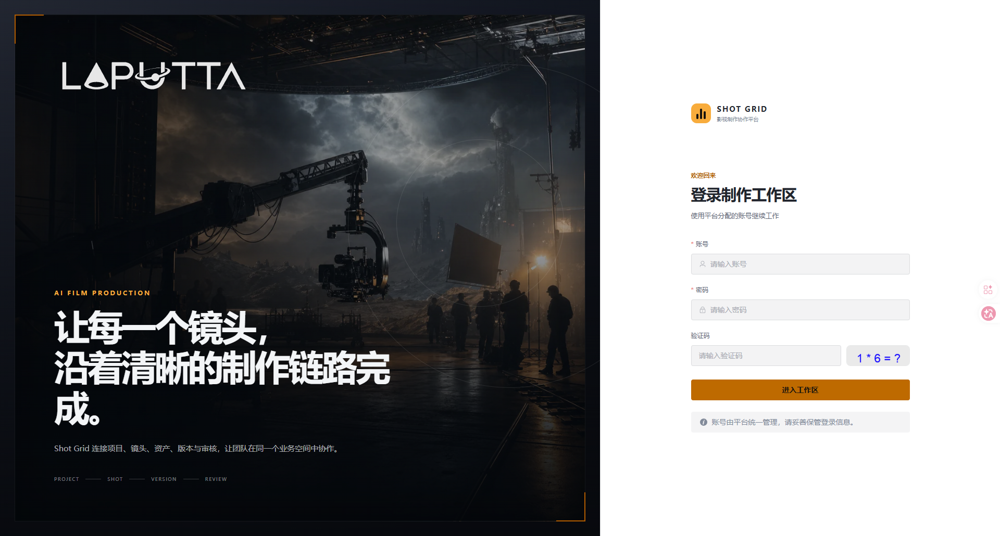
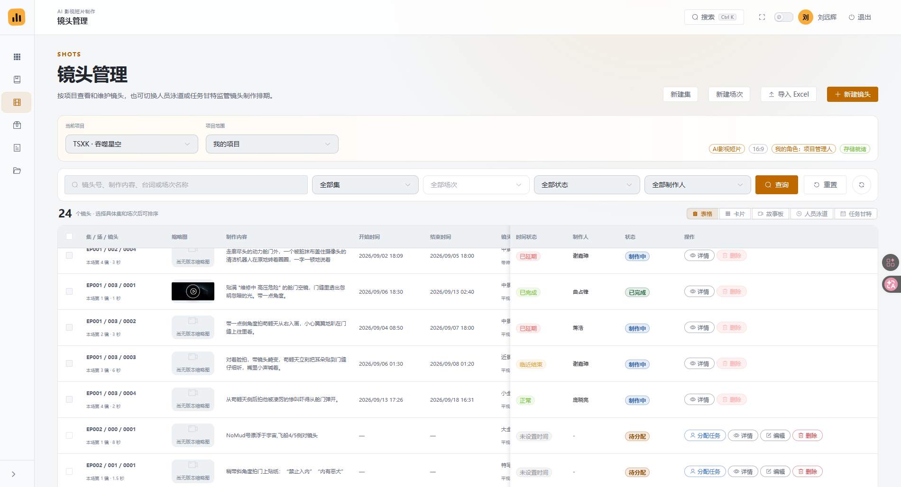
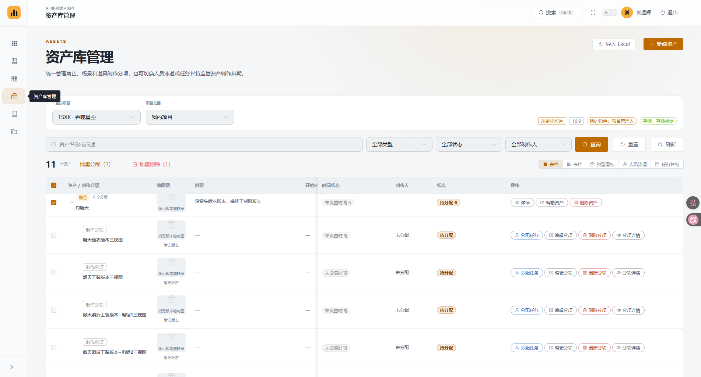
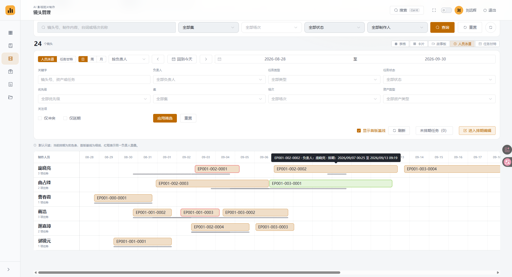
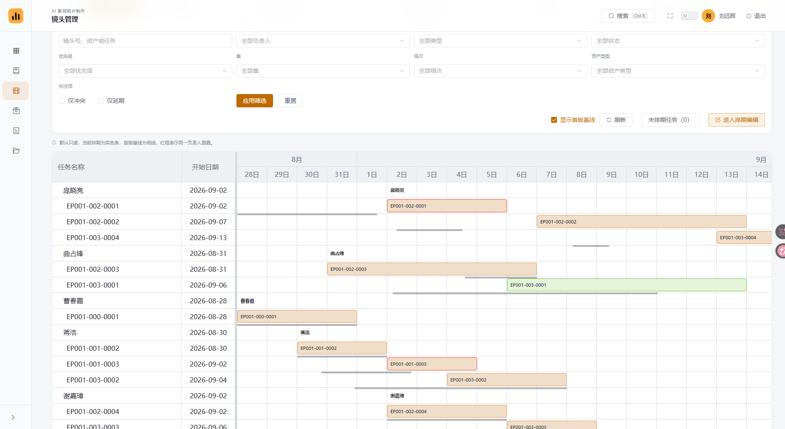
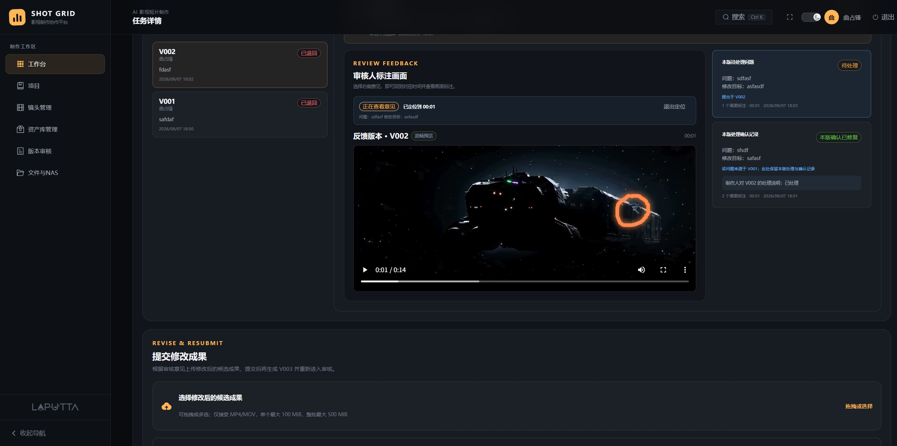
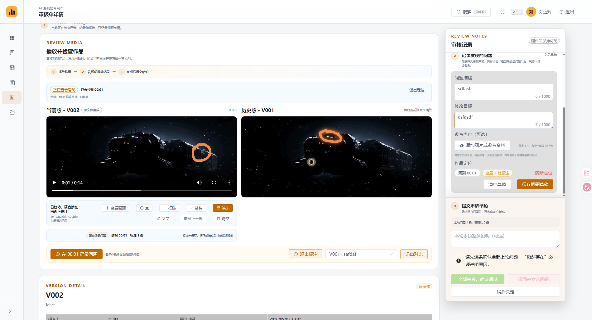

# 项目介绍与界面预览

[返回启动首页](../README.md)

截图用于了解页面布局，可能早于当前版本；现行流程以实际页面和业务契约为准。

## 核心能力

- 项目结构：项目、集、场次、镜头，以及角色、场景、道具三类资产。
- 制作协作：镜头或资产制作分项对应唯一任务，支持委派、改派、分配后自动准备目录和进度跟踪。
- 版本管理：版本不可变，保留提交文件、制作说明、媒体派生和完整历史。
- 审核闭环：审核问题、画面标注、退回修改、再次提交与最终版本确认。
- 文件与目录：受保护文件、业务引用、NAS 目录任务、版本发布和缩略图/代理媒体派生。
- 平台治理：用户、角色、项目成员、数据范围、权限菜单、审计日志和系统配置。

核心业务链路：

```text
项目
  ├─ 集 → 场次 → 镜头 → 唯一制作任务 ─┐
  └─ 资产 → 制作分项 → 唯一制作任务 ─┤
                                      ↓
                               不可变版本提交
                                      ↓
                              审核通过 / 退回修改
                                      ↓
                               最终版本与制作履历
```

## 系统界面预览

以下截图展示 Shot Grid 从制作工作区登录、镜头与资产管理，到人员排期、任务修改和版本审核的主要界面。

### 登录制作工作区

使用平台账号进入影视制作协作工作区。



### 镜头管理

按项目查看镜头、制作内容、负责人、排期和制作状态。



### 资产管理

以父资产和制作分项的层级结构，查看资产内容、分项负责人和制作进度。



### 人员任务（历史界面截图）

按制作人员查看时间轴上的任务安排，直观了解每个人的制作排期。



### 制作排期（历史界面截图）

通过甘特视图查看任务的时间安排。



### 任务详情与修改反馈

制作人员查看版本历史、画面标注和审核问题，并提交修改成果。



### 版本审核

并排对比当前版本与历史版本，在画面上标注问题、填写修改目标并提交审核结论。



## 技术架构

```text
浏览器
  ├─ Shot Grid 业务前端（Vue 3 / Element Plus，端口 5174）
  └─ 平台管理端（Vue 3 / Element Plus）
                │ Axios / Vite 或 Nginx 代理
                ▼
FastAPI（端口 9099）
  ├─ Controller → Service → DAO → SQLAlchemy
  ├─ PostgreSQL：业务数据、版本、审核、任务和 Outbox
  ├─ Redis：会话、缓存、限流、日志流和分布式协调
  ├─ 受保护文件：上传、引用、下载、回收和完整性校验
  └─ Worker：NAS 目录、版本发布、缩略图和代理媒体派生
```

当前主数据库是 **PostgreSQL**。仓库保留的 MySQL 文件和 Compose 仅属于兼容能力，不代表当前项目的默认运行环境。

## 仓库结构

| 路径 | 说明 |
| --- | --- |
| `shot-grid-frontend/` | Shot Grid 独立业务前端，日常业务开发的主要入口 |
| `ruoyi-fastapi-backend/` | FastAPI 后端、Shot Grid 业务模块、迁移、SQL 与 Worker |
| `ruoyi-fastapi-frontend/` | 平台管理端，用于用户、角色、菜单、文件、插件和系统配置 |
| `ruoyi-fastapi-test/` | 独立 Playwright 端到端测试工程 |
| `docker-compose.dev.yml` | 本地开发：后端、PostgreSQL、Redis |
| `docker-compose.pg.yml` | PostgreSQL 完整部署参考拓扑 |
| `docker-compose.my.yml` | 保留的 MySQL 兼容拓扑，不是当前默认路径 |
